<!-- Every image here is rendered from data/profile.json by scripts/generate.mjs. Edit the JSON, not the SVGs. -->

  <picture>
    <source media="(prefers-color-scheme: dark)" srcset="./assets/dark/hero.svg">
    
  </picture>

  <a href="https://saulromero.dev"><picture><source media="(prefers-color-scheme: dark)" srcset="./assets/dark/link-portfolio.svg"></picture></a>
  <a href="https://www.linkedin.com/in/sa%C3%BAl-romero-cruz-64a242236/"><picture><source media="(prefers-color-scheme: dark)" srcset="./assets/dark/link-linkedin.svg"></picture></a>
  <a href="mailto:contacto@saulromero.dev"><picture><source media="(prefers-color-scheme: dark)" srcset="./assets/dark/link-email.svg"></picture></a>
  <a href="https://x.com/itsaulromero"><picture><source media="(prefers-color-scheme: dark)" srcset="./assets/dark/link-x.svg"></picture></a>

 

  <picture>
    <source media="(prefers-color-scheme: dark)" srcset="./assets/dark/stack.svg">
    
  </picture>

 

  <picture>
    <source media="(prefers-color-scheme: dark)" srcset="./assets/dark/activity.svg">
    
  </picture>

