<!--
  Every image here is an animated SVG rendered with Node from data/profile.json
  (see scripts/). Edit that JSON, not the SVGs: the "Profile" workflow redraws
  the cards and this README. Activity refreshes on its own every day.
-->

<picture><source media="(prefers-color-scheme: dark)" srcset="assets/banner-dark.svg"></picture>
<a href="https://saulromero.dev"><picture><source media="(prefers-color-scheme: dark)" srcset="assets/contacto-web-dark.svg"></picture></a><a href="https://www.linkedin.com/in/sa%C3%BAl-romero-cruz-64a242236/"><picture><source media="(prefers-color-scheme: dark)" srcset="assets/contacto-linkedin-dark.svg"></picture></a><a href="mailto:contacto@saulromero.dev"><picture><source media="(prefers-color-scheme: dark)" srcset="assets/contacto-email-dark.svg"></picture></a><a href="https://x.com/itsaulromero"><picture><source media="(prefers-color-scheme: dark)" srcset="assets/contacto-x-dark.svg"></picture></a>
<picture><source media="(prefers-color-scheme: dark)" srcset="assets/stack-dark.svg"></picture>
<picture><source media="(prefers-color-scheme: dark)" srcset="assets/actividad-dark.svg"></picture>
 Animated SVGs rendered from <a href="data/profile.json"><code>data/profile.json</code></a> · activity refreshes every day

